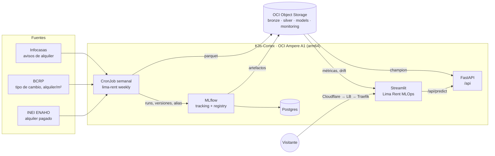
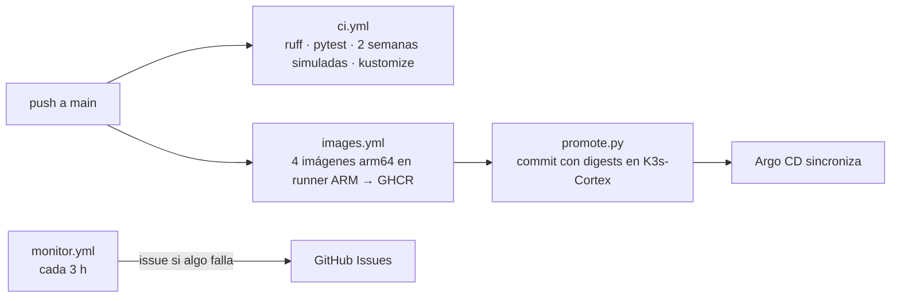

# Lima Rent MLOps

Estima el alquiler mensual de un departamento en Lima Metropolitana y vigila, semana a semana, si el modelo sigue acertando.

El proyecto es un ciclo MLOps completo sobre datos reales que cambian:

- Cada lunes llegan avisos nuevos, que sirven de *ground truth* para medir al modelo en producción.
- Se mide el drift de los datos.
- Se reentrena cuando hace falta.
- El modelo nuevo solo reemplaza al actual si es mejor.

Todo corre en la capa gratuita de Oracle Cloud.

**Demo:** https://lima-rent.renzoaguilar.dev · **API:** https://lima-rent.renzoaguilar.dev/api/docs (tras el primer despliegue)

> Proyecto educativo. No es una tasación. Ver [docs/datos.md](docs/datos.md) sobre las fuentes y sus términos de uso.

## Qué hace

| Página | Qué muestra |
|---|---|
| **Predictor** | Alquiler estimado (mediana) con su intervalo del 80 %. Si ingresas el precio de un aviso, dice si está caro, barato o en rango. |
| **Salud del modelo** | MAE, MAPE y cobertura del intervalo semana a semana, medidos sobre avisos que el modelo no vio. Incluye mapa de error por distrito y residuos. |
| **Drift** | PSI y KS de cada variable frente a los datos de entrenamiento, y precio por m² por distrito comparado con las series del BCRP y la ENAHO. |
| **Historial de modelos** | Cada reentrenamiento, por qué ocurrió y si el challenger fue promovido o rechazado. |
| **Calidad de datos** | Avisos descartados por cada regla de limpieza, nulos y resumen de la última corrida. |

## Arquitectura



### La corrida semanal (`lima-rent weekly`)

1. **Ingesta:** scraping lento de Infocasas → `bronze/`.
2. **Limpieza y validación** con Pandera → `silver/listings.parquet`, un historial que guarda cuándo se vio cada aviso por primera vez.
3. **Ground truth:** el champion predice los avisos nuevos antes de verlos. Se registran el MAE, el MAPE y la cobertura del intervalo, en total y por distrito.
4. **Drift:** PSI (y KS para las numéricas) de cada variable, del precio por m² y de las predicciones, frente a la muestra de entrenamiento del champion.
5. **¿Reentrenar?** Sí cuando pasa alguna de estas cosas:
   - no hay champion;
   - alguna variable supera PSI 0.2;
   - el MAPE semanal supera el 25 %;
   - se fuerza a mano.
6. **Entrenamiento:** split temporal y Optuna (TPE) sobre tres LightGBM de regresión por cuantiles (p10, p50 y p90) del log del precio. Se registra en MLflow con el alias `challenger`.
7. **Promoción:** el challenger reemplaza al champion solo si mejora el MAE al menos un 1 % sobre el mismo holdout. Al promoverlo, se mueve el alias `champion` y se exporta el modelo a `models/champion/` en el bucket.
8. La API recarga el champion en menos de 5 minutos, **sin redesplegar**.

### CI/CD



## Decisiones de diseño

- **CronJobs de Kubernetes en vez de Prefect o Airflow.** El pipeline es una secuencia semanal sin ramas. El clúster ya programa, reintenta y guarda el historial de jobs, y no hace falta un orquestador corriendo los otros 6 días.
- **PSI y KS escritos a mano en vez de Evidently.** El módulo entero (`monitoring/drift.py`) tiene menos de 90 líneas de numpy y scipy, es fácil de explicar y no suma cientos de MB a la imagen.
- **Regresión por cuantiles.** Un rango honesto ("entre S/ 4 200 y S/ 5 400") es más útil que un número exacto. Además, la cobertura del intervalo es una métrica de monitoreo más.
- **La API no depende de MLflow.** El champion se exporta como archivos de texto de LightGBM al bucket, así que la API carga 3 archivos y su imagen no trae MLflow ni Optuna. MLflow queda para el experimento, el registro y la auditoría.
- **Promoción con regla explícita.** Champion y challenger se comparan sobre el mismo holdout. Cada decisión, con su razón, queda en MLflow y en `models/history.json`.
- **Imágenes solo arm64.** La VM es Ampere A1. Se construyen de forma nativa en el Mac y en runners `ubuntu-24.04-arm`, sin QEMU ni manifiestos multi-arquitectura. Son multi-stage: el runtime solo trae Python y el entorno virtual.
- **Cada imagen instala solo su extra de uv** (`pipeline`, `api`, `dashboard` y `tracking`). Un test bloquea los paquetes ajenos para detectar importaciones que fallarían dentro del contenedor.
- **Imágenes recortadas y en dos capas.** `docker/podar-venv.sh` quita de cada entorno las pruebas de las librerías, las cabeceras C y los clientes sin uso (entre 21 % y 39 % menos al descargar), y el pipeline usa `mlflow-skinny` en vez de MLflow completo. Las dependencias van en una capa y el código en otra de ~100 KB, así que un despliegue normal solo descarga la segunda.
- **GitOps por digest.** Lo que corre en el clúster es exactamente la imagen que se probó. Revertir es revertir un commit en K3s-Cortex.

## Desarrollo local

Requisitos: [uv](https://docs.astral.sh/uv/), Docker, `kubectl` y, en macOS, `brew install libomp` (OpenMP para LightGBM).

```bash
make install   # uv sync --all-extras
make check     # ruff
make test      # pytest: datos sintéticos, sin internet
make smoke     # dos semanas simuladas: modelo inicial y luego drift + reentrenamiento
```

Todo el sistema en Docker: SeaweedFS imita a OCI Object Storage, y se levantan además Postgres, MLflow, la API y el dashboard.

```bash
make up        # http://localhost:8501 (dashboard) · :8080/api/docs · :5001 (MLflow)
make demo      # corre dos semanas sintéticas dentro de compose
make down
```

Contra datos reales (scraping de Infocasas, lento a propósito):

```bash
cp .env.example .env
uv run lima-rent context            # series del BCRP y la ENAHO
uv run lima-rent weekly --max-pages 5
uv run lima-rent status
```

## Estructura

```
src/lima_rent_mlops/
  sources/        infocasas.py (scraping) · bcrp.py · enaho.py
  processing/     schemas.py (Pandera) · clean.py · features.py
  training/       model.py (LightGBM por cuantiles) · train.py (Optuna + MLflow)
                  champion.py · promote.py · registry.py · evaluate.py
  monitoring/     drift.py (PSI, KS) · performance.py
  serving/        api.py (FastAPI)
  dashboard/      app.py + pages/ (Streamlit)
  pipeline.py     la corrida semanal · cli.py (`lima-rent`) · storage.py (local o S3)
docker/           un Dockerfile por imagen (arm64, multi-stage)
deploy/compose/   sistema completo en local
deploy/k3s/       base + overlay prod (kustomize)
deploy/argocd/    Application para K3s-Cortex
scripts/          promote.py (GitOps) · crear-secretos.sh
docs/             datos.md · despliegue.md
```

## Despliegue

Ver [docs/despliegue.md](docs/despliegue.md): el flujo GitOps, los recursos del namespace y los pasos únicos (claves, Secrets, Argo CD, DNS y la primera corrida).

## Stack

Python 3.12 · uv · pandas · Pandera · LightGBM · Optuna · MLflow · FastAPI · Streamlit · Altair · OCI Object Storage (API S3) · Docker (arm64) · K3s · Kustomize · Argo CD · Traefik · Cloudflare · GitHub Actions
